<h1 align="center">🌀 Worldhopper Engine</h1>

<p align="center">
A SillyTavern extension for metaphysics roleplay: possession, body swaps, mind control, hive minds, dolls, time stops, and more.<br>
It keeps the rules, the bodies, and the prose straight, so the model stops getting them wrong.
</p>

<p align="center">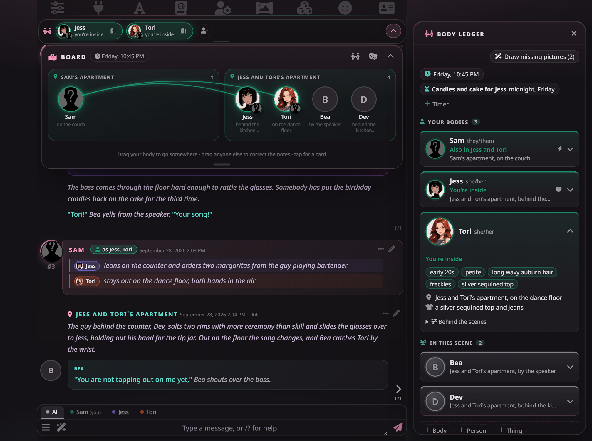</p>
<p align="center"><sub>New in 2.0: <a href="#-stage-mode">Stage mode</a>, an optional new look with a Board of who is where, here with the Body Ledger open as a sheet.</sub></p>

It pairs with the [Worldhopper presets](https://coz-rp.github.io/) (a flagship for every model, plus one each for Claude, Gemini, DeepSeek, GLM, and Kimi and MiMo), and works with any other preset, Chat Completion or Text Completion. With a Worldhopper preset, switch on its ✚ Metaphysics Check in metaphysics chats (the Modes panel offers to when it's off): it reads the Body Ledger and Mind Book before each reply.

> 🧩 **Only what you're into.** Every mode is opt-in and picked per character, and nothing is on until you pick it. If mind control is your thing, pick Mind Control and that's all you'll ever get: no possession rules, no body swaps, no boxes or cards for modes you didn't choose. Mix as many or as few as you like, and change them any time.

> ⚡ **Keep it fast and cheap.** Give the Engine its own model, separate from the one you roleplay with. Its jobs are small background ones, and the Ledger runs after every single reply, so a local model (KoboldCpp, Ollama, and the like) or a cheap, fast API model from the Flash, Haiku, or mini tier does them well and costs next to nothing. Your big roleplay model would work too, but every background call would cost big-model prices, and your next reply waits for the Ledger to finish.

> 🆕 **New in 2.0:** [Stage mode](#-stage-mode), an optional new look for all of SillyTavern with a Board of who is where; [World notes](#-world-notes) (things that matter, who knows what, where everyone is, what they have on, and the story's clock); [card rules](#️-card-rules) you set with a tap; [quick actions](#-quick-actions) to possess and release from the strip; the Ledger and Mind Book as one card per person with everything editable; [Test this card and Check the greetings](#-card-tools); and change that builds over time.

## Contents

- [✨ What it does](#-what-it-does)
- [🚀 Install](#-install)
- [🧭 Quick start](#-quick-start)
- [🎭 Modes](#-modes)
- [🎛️ Card rules](#️-card-rules)
- [📒 Body Ledger](#-body-ledger)
- [⚡ Quick actions](#-quick-actions)
- [🌍 World notes](#-world-notes)
- [🪞 Host personas](#-host-personas)
- [🧠 Mind Book](#-mind-book)
- [🖼️ Pictures](#️-pictures)
- [👥 Running several bodies](#-running-several-bodies)
- [💥 Moment boxes](#-moment-boxes)
- [🎬 Stage mode](#-stage-mode)
- [✍️ WH Editor](#️-wh-editor)
- [🪪 Card tools](#-card-tools)
- [⚙️ Every setting](#️-every-setting)
- [⌨️ Slash commands](#️-slash-commands)
- [🧰 The regex scripts](#-the-regex-scripts)
- [🔒 Privacy](#-privacy)
- [❓ Troubleshooting](#-troubleshooting)

## ✨ What it does

| | |
|---|---|
| 🎭 **Codex modes** | Rules for 21 kinds of metaphysics, switched on only in the chats of characters that use them. |
| 🎛️ **Card rules** | How this card's power works (how a rider gets in, what the host remembers, how it ends), picked with a tap or read from the card, and given to the writer in a few lines. |
| 📒 **Body Ledger** | In possession-type chats, records after every reply who is in which body and who holds which power, then feeds it back to the model. Tap its strip for one card per person, every part of it changeable in place. |
| 🌍 **World notes** | Kept beside the Ledger: the things that matter and who has them, who knows what about the powers, where everyone is and what they have on, and the story's day, time, and deadlines. |
| ⚡ **Quick actions** | Possess someone, release a body, or jump to someone new right from the strip, and the Ledger knows before the reply is written. |
| 🧠 **Mind Book** | What Hypnosis, Mind Control, and Altered Perception have put into people (trance stages and triggers, a controlled will, who can't perceive what), and change that builds each time a power is used. |
| 🪞 **Host personas** | Part of the Ledger: three short lines on who a taken body is in their own life, so the people around them stay true to that person. |
| 🖼️ **Pictures** | A face for everyone in the Ledger and the Mind Book, drawn by your own Image Generation setup when you ask (or on their own). |
| 👥 **Body tabs** | Run several bodies at once and the message box gets a tab per body, each with its own draft, joined into one message when you send. |
| 💥 **Moment boxes** | A takeover, an absorption, a trance, a will taking hold, time stopping, a swap, a transformation: each mode's big moment gets its own styled box. |
| 🎬 **Stage mode** | An optional new look for all of SillyTavern: replies as narration and each speaker's lines with their own face, a Board of who is where, and the books as sheets. |
| ✍️ **WH Editor** | A separate extension that pairs with this one: flags stock phrases, "not X, but Y" framing and chopped dialogue, and has a model rewrite only those lines. |
| 🪪 **Card tools** | Make a card from a Card Builder chat, and check any card: test replies, greetings, and the things that trip models up. |

## 🚀 Install

1. In SillyTavern, open **Extensions** → **Install extension**, and paste:
   ```
   https://github.com/Coz-rp/SillyTavern-Worldhopper
   ```
2. Open **Extensions → Worldhopper Engine → Settings → Models** and pick a connection profile for each job: a local or cheap, fast model, not your roleplay model (see [Models](#models)).
3. Open a character and pick its modes. That's it.

**You need** SillyTavern with the built-in Connection Manager (tested on 1.18), and a connection profile for the Engine's jobs (plug menu → Connection Profile), ideally pointing at a local or budget model. No special preset is needed: the Engine writes its own prompts, and a profile's preset only lends its sampler settings.

**On first start** the extension installs its lorebook, **WH Metaphysics**, and a handful of display-only regex scripts (see [The regex scripts](#-the-regex-scripts)). Both update themselves with the extension. If you edit your copy of either, your edits stay, and the extension asks before replacing anything.

**By hand:** copy this folder into `SillyTavern/public/scripts/extensions/third-party/` and restart SillyTavern.

**Updating from 1.x:** your chats, Ledgers, Mind Books, pictures, and settings carry over. SillyTavern needs one reload after the update.

## 🧭 Quick start

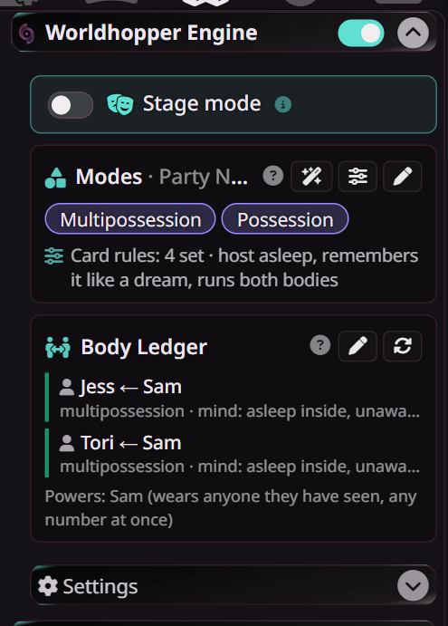

1. Open a chat with a character.
2. In **Extensions → Worldhopper Engine**, tap ✏️ under **Modes** and pick what this character uses, or tap 🪄 to have some suggested from the card.
3. Play. After each reply the Ledger updates, and the strip above the chat shows who is where. With Hypnosis, Mind Control, or Altered Perception picked, the Mind Book's bar sits under it. Tap either bar to see it all as cards, and to change anything in it.
4. Want the new look? Switch on **Stage mode** at the top of the panel.

Every section of the panel has a ❔ button that explains it in a few lines, and every switch in Settings has an ⓘ beside its name: point at it, or tap it on a phone.

<br clear="right">

## 🎭 Modes

A mode is one kind of metaphysics, with its own rules: how it's done, what the subject experiences, who writes what. The rules live in the **WH Metaphysics** lorebook, the Codex. Its entries stay off everywhere, and Worldhopper switches on only the ones for the modes you picked, only in that character's chats.

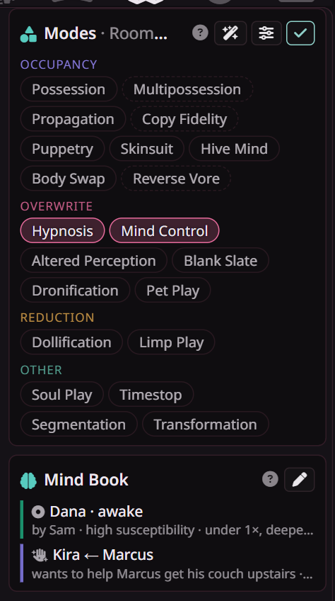

- **Picked per character** (or per group chat). Tap ✏️ to pick, 🪄 to get suggestions from the card, and tap a picked mode to read what it means.
- **Pick the fewest that carry the card.** Every picked mode is written into every reply, so a mode the card only hints at does more harm than good.
- **Modifiers** (↳) build on another mode and bring it in with them: Multipossession brings in Possession.
- **What gets added:** the core rules, plus the rules for bodies only with modes where a mind drives someone else's body (and the rules for one mind running several bodies only with Multipossession, Hive Mind, or Puppetry), so a Hypnosis chat doesn't pay for them; a one-line reminder per mode near the end of the prompt, where it carries the most weight, along with one that characters who have a power use it on their own; and detail entries that switch on when the chat touches their topic, like trance depth or a skinsuit going on.
- **Modes that meet:** a few short notes cover what happens where two picked modes overlap (hypnotizing someone you're possessing, say). Each switches on only when every mode it names is picked, never from one mode alone.
- **Your card wins.** The card sets the specifics (how a power works, what it costs, what the subject remembers); a mode's defaults only fill in what the card leaves out.

<br clear="right">

| Family | Mode | What it is |
|---|---|---|
| **🧍 Occupancy** | Possession | a mind moves into a living host and drives it |
|  | ↳ Multipossession | one mind drives several hosts at once (brings in Possession) |
|  | Propagation | a host's mind is overwritten by a copy of someone else's |
|  | ↳ Copy Fidelity | copies of the player character appear in the story (brings in Propagation) |
|  | Puppetry | an empty body driven from outside by a controller in their own skin |
|  | Skinsuit | a host's hollow skin is worn from within like a garment |
|  | Hive Mind | minds absorbed into a single network that is the original mind |
|  | Body Swap | two people trade bodies, each mind awake and living the other's life until it's undone |
|  | ↳ Reverse Vore | entry by being swallowed, then control seized from inside (with any occupancy mode; brings in Possession if none is picked) |
| **🧠 Overwrite** | Hypnosis | realistic trances that deepen in stages over sessions, with suggestions sincerely rationalized as the subject's own |
|  | Mind Control | the mind itself taken over: wants, feelings and beliefs set by the controller and felt as the subject's own |
|  | Altered Perception | premises edited so the altered normal is defended as always true |
|  | Blank Slate | a mind wiped to a genuine void |
|  | Dronification | personality stripped and replaced with function and designations |
|  | Pet Play | the mind becomes an animal's while the body stays human |
| **🪆 Reduction** | Dollification | a blank, poseable doll with nobody home |
|  | Limp Play | the body goes completely slack, dead weight |
| **✨ Other** | Soul Play | souls as objects that can be moved, split, merged or stored |
|  | Timestop | time frozen for everyone except whoever stopped it |
|  | Segmentation | body parts removed and exchanged freely |
|  | Transformation | a body physically changes form (sex, build, species) while the mind stays the same person |

## 🎛️ Card rules

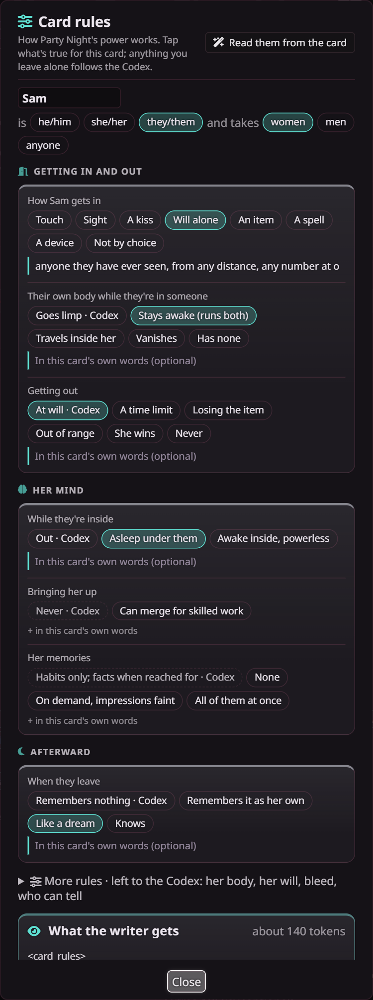

How this card's power works, as a few settings instead of paragraphs of prose. Tap the sliders button on the **Modes** card.

- **Tap what's true:** whose power it is and who they usually take; how the rider gets in (touch, sight, a kiss, an item…); what their own body does meanwhile; how it ends; whether the host is out, asleep, or awake inside; what the host remembers afterward; and more under **More rules**. Anything you leave alone follows the Codex.
- **In the card's own words:** each setting takes a line of detail for what the card says that the option doesn't (where the clothes end up, a record ride).
- **Read them from the card:** your Notes model fills the settings in from the card's own prose and shows what it would cut from the description, so the card sends fewer tokens. Nothing changes until you save it, and it can be undone.
- **Change that builds:** a power that changes someone a little each time (fast, slowly, or holding after a few uses), and whether it fades when left alone. The Mind Book counts the uses.
- **What the writer gets** shows the few lines that go into the prompt. They're saved in the card itself, so they travel with it.

<br clear="right">

## 📒 Body Ledger

The Ledger is for the modes where one mind lives in another's body: Possession, Multipossession, Skinsuit, Hive Mind, Body Swap, Reverse Vore, Propagation, and Copy Fidelity. In a chat with none of those it stays out entirely, even if the chat holds Ledger entries from before: it doesn't run, doesn't go into the prompt, and doesn't show, so a hypnosis or mind control chat is the Mind Book's alone. Pick one of those modes and the Ledger comes back as it was. After each reply, a model you choose reads the newest messages and updates a record of:

- 🧍 **Bodies** that aren't driven by their own mind: possessed, worn as a skin, absorbed into a hive, overwritten by a copy, swapped. Also empty bodies, and minds with no body. The owner's mind always says where it is (asleep inside, awake and powerless, pushed out), never just "gone".
- ⚡ **Powers**: who can do what, even when nobody is using it.
- 🏷️ **Names**: one person under several names (a code name, a host number).
- 🙈 **Whether you know.** Anything kept from you stays out of the narration.

The record goes into the prompt just before the model writes, so names, pronouns, and every change stay straight. Your bodies are yours to play: the writer does only what your message did with them, and leaves their words, choices, and feelings to you. When something is done to you, the model plays your changed behavior and leaves your inner experience to you.

**You are "you" in any body.** In a body you're driving, the story calls you "you" for the body, its parts, and everything it does ("your shoulders pop as you reach overhead"). What belongs to the host's life stays hers ("Dana's phone lights up beside her water bottle"); only your own things are "your". With several bodies, the body's name says which one is moving ("as Jess, you pour two margaritas"). People who don't know still see Dana and call her Dana; people who know talk to you by your own name.

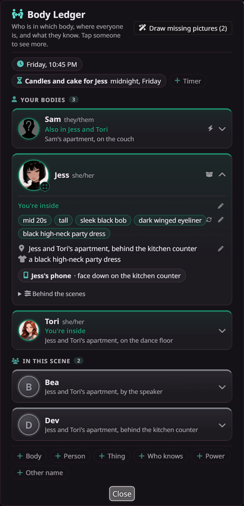

**The strip** above the chat shows it at a glance, with each body's face: 🟢 teal when you're the one inside, 🟣 violet when someone else is, dashed when a body is empty, and a crossed-out eye when a ride is kept from you. Tap it to open the Ledger.

**One card per person:** you and your bodies first, then the people in the scene, then bodies elsewhere, with everyone else folded away. Each card is a short preview (who's inside, where they are); tap it for everything about that person: their look as a few short details (a ~ marks a guess), where they are and what they have on, what they carry, what they know, their powers, their sheet, and their past rides. What the model needs but you rarely do sits under **Behind the scenes**.

**Changing it:** everything on a card can be changed or deleted. Each part has its own faint ✏️ (it shows when you point at the card), which opens a small form for just that part. **+** adds a body, a person, a thing, who knows what, a power, or another name. **Not in this scene** takes someone out of the scene until the story names them again. The next update builds on your change.

<br clear="right">

**Your pronouns:** SillyTavern has no pronoun field, so the Engine adds one, per persona: in Persona Management, under the description, and under Settings → Choices. The writer is told them plainly, so a he isn't written as she in a chat full of women's bodies.

**"As …" badges** on your messages show whose body you wrote them from.

**Body History** remembers past body changes: who was inside, what the owner remembers, what they now believe happened, what they were held to, who saw, and what was kept or left behind. For a chat that started before the Ledger was on, **Build history from earlier replies** reads the replies that have no Ledger entry yet, once each. On a long chat it offers to read just the last 30 instead of the whole thing.

**It never rereads the chat.** After each reply the Ledger reads only the newest messages, alongside what it already knows.

**Two checks on every reply** while someone is in another body, Text Completion included: **pronouns** (a body's own, and the mind's inside it) are checked against the Ledger, and lines that break the **body rules** are cut (one mind's bodies chatting with each other, narration pointing out who's inside, hints at things you haven't been told). The check reads your message too, so two of your bodies each answering you isn't mistaken for them talking to each other, and a cut has to name the rule it breaks. ⟲ in the message menu brings the original back.

**A body stays on until it's let go.** A possession ends only when the chat shows it ending: the driver leaving, being forced out, or letting go, or the owner taking back control. A scene moving elsewhere, or a body nobody has mentioned for a while, ends nothing. When an update does take a body off, a second, quick check confirms it first.

**Fixing mistakes:** ✏️ on the panel opens the Ledger's cards, the same as the strip. 🔄 rebuilds it from the card and the last few messages. Edit the newest reply itself (writing a possession in or out of it) and the Ledger, the World notes, and the Mind Book read it again.

**Which model:** the Ledger runs after every reply, and your next reply waits for it, so give it your fastest, cheapest model: a local one, or the Flash, Haiku, or mini tier. The Ledger, the World notes, and the Mind Book read a reply side by side, so they take no longer than the slowest of them. Under the Ledger's status, **Last turn** shows how long your send waited.

## ⚡ Quick actions

In chats with Possession, the strip carries the moves themselves:

- **+** at the end of the strip: possess someone. The strip turns into the people in the scene, plus a box to type anyone else. In a one-body story, while you're already in someone, the **+** jumps: you leave that body for the new one. With Multipossession it adds a body.
- **A door** on each of your bodies: release it.
- **Hive Mind** (without Possession): the **+** absorbs someone into your hive, and the door releases them from it.

A tap writes the move into your message (*I possess Jen.*) without sending it, so you can keep typing. If the line is still there when you send, the Ledger records the move on your message before the reply is written, so the writer already knows. The moves stay hidden while the Ledger says the power is someone else's.

## 🌍 World notes

Kept beside the Ledger, by the same model and in the same moment, for what a story would otherwise lose:

- 📦 **Things that matter:** clothes left behind in a swap, a phone someone else is holding, keys handed over, an object with a power. Each has its owner, who holds it now, and where it is.
- 👁️ **Who knows what** about the powers, and how they came by it (saw it, was told, figured it out, suspects, was lied to). People act on this and nothing more, and an odd moment gets an ordinary explanation (tired, drunk, a bad week) until the signs pile up.
- 📍 **Where everyone is** and what they have on, as "place, spot" (Corner Café, behind the counter), so two of your bodies in different rooms stay apart. When your bodies are in different places, a reply comes as one scene per place, each with its own heading.
- 🕰️ **The clock:** the story's day and time, moved only when the story moves it, and **deadlines** (a rental that runs out at six, a party at nine) with the time left.

They show on the Ledger's cards and its clock line, and every part can be changed there like the rest. The writer gets only what concerns the people in the scene, plus the clock.

## 🪞 Host personas

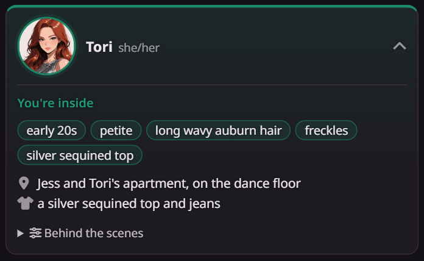

Part of the Body Ledger. When someone takes over a body that has no card of its own (a coworker, a stranger, a host the story just met), the Ledger writes a short sheet on who that person is in their own life.

- **Three lines:** Look, Voice & habits, and Life, about 60 words in all, so several hosts cost the prompt very little. The look is a few short details ("early 20s · petite · long wavy auburn hair · freckles").
- **Written once** by your Notes model (the Ledger's, if you haven't picked one), from the card and the chat, the first time the Ledger shows the body taken. You, the character, and group members have cards already, so they don't get one.
- **In the prompt while it matters:** under the body's Ledger row while someone else drives it and it's in the scene, so the people around it keep treating it as who it was; and after it's released, for as long as that person is still in the scene, since the model is playing them again. A body off somewhere else keeps its Ledger row but not its sheet, so a chat full of hosts doesn't grow the prompt.
- **On the person's card:** ✏️ on the sheet changes it or deletes it, and 🔄 writes it again. Delete one while someone is still in the body and no new one is written for the rest of that ride; ✒️ writes one whenever you want it.
- **Make a persona:** 🪪 on a sheet makes a SillyTavern persona of that person, with their picture and a description built from the sheet (change it first if you like), to play as in this chat or any other.
- **Hosts are adults.** A sheet that describes someone as a minor isn't kept.

<br clear="right">

## 🧠 Mind Book

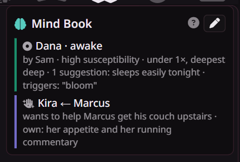

The Body Ledger's counterpart for the modes that change a mind instead of moving one: **Hypnosis**, **Mind Control**, and **Altered Perception**. Each keeps its own record, updated by its own small prompt, so they never blur into each other or into the Ledger.

- 🌀 **Hypnosis** is realistic: inductions take patience, depth comes in stages (light, medium, deep, somnambulistic), and every session makes the next one quicker and deeper. For each subject the book keeps who hypnotizes them, how susceptible they are, how many times they've been under and how deep, where they are right now, the suggestions planted (each with the stage it went in at, which decides how long it lasts and what's remembered), triggers, and whether they were told to forget. The prompt gets only the line for where they are right now: what this stage allows, and how it shows.
- 🎯 **Mind Control** keeps each controlled person's will: what the controller set (wants, feels, believes, loyal to, standing commands), with a newer setting replacing an older one, and what is still their own. Unless the card or the story in play makes them drones or zombies, or sets them up as aware of it and pushing against it, they stay fully themselves apart from their will, pursue it in their own way, and nothing in them strains against it.
- 👁️ **Altered Perception** keeps each edit: someone who can't be perceived, a changed normal, or a false fact, and exactly who has it (names, or everyone but a few).
- 🌱 **Change over time**, with any mode, when the card rules say a power changes someone a little each time: the book counts each use, the writer is told whether it's just started, growing, or holding, and, if the card says so, it fades when left alone, on the story's clock.

**Lines for the moment**, with no model involved:

- a trigger word in your newest message: it fires, if the subject heard it;
- a controlled person in the scene: their will is simply what they want right now;
- someone who can't be perceived, in the same scene as the people who can't perceive them: how the scene looks from their side, and who sees normally.

**It updates only when needed:** on a reply with a trance or control moment, while someone is still under, when someone the book holds is named, or when the new messages use that mode's words. Most replies cost nothing. The first update in a chat reads the card.

**Only the scene in full:** people named in the last few messages, anyone in a trance right now, and edits everyone has get their full entry in the prompt. Everyone else is a name on one short line, and their full entry comes back once they're in a scene again.

**No trapped self.** In Mind Control chats, a sentence that writes an inner scream or a part of them fighting it is cut, no model needed, unless a struggle has been set up: by the card, by your own message, or earlier in play. ⟲ brings it back.

<br clear="right">

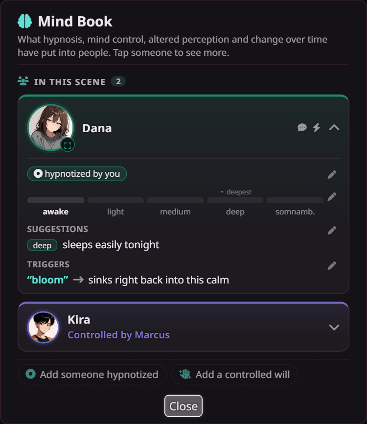

**The bar** above the chat, under the Ledger's strip, shows it at a glance: a chip for each hypnotized person, each controlled will, each perception edit, and each change under way, with their faces. 🟢 Teal when you're the one doing it, 🟣 violet when someone else is, and a crossed-out eye when it's kept from you. Tap it for one card per person: a trance meter, their suggestions and triggers, what was set in their will and what's still theirs, and their changes; the perception edits get cards of their own.

**Fixing mistakes:** every part of a card has its own ✏️, and **+** adds someone. ✏️ on the panel opens the same cards. The next update builds on your fix.

<br clear="right">

## 🖼️ Pictures

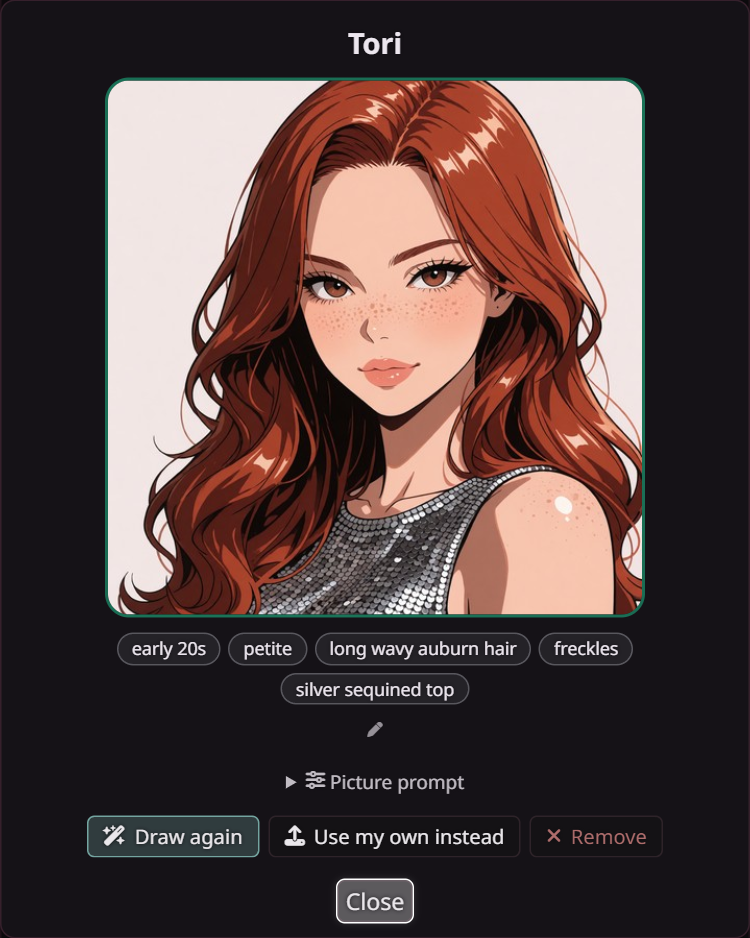

Anyone in the Ledger or the Mind Book without a card of their own can have a picture; people with a card show its avatar. Tap someone's face to see it large, and to **Draw** it, use a picture of your own, or remove it. Pictures show on the cards and as small faces on the bars above the chat. **Draw missing pictures**, at the top of the Ledger and the Mind Book, draws everyone there who doesn't have one yet, one after another.

- **Drawn by SillyTavern's Image Generation, however you've set it up:** whichever source, model, workflow, and style it uses. Under **Settings → Pictures** you can pick a different style, model, or (for a source that has them) workflow just for these pictures. The lists come from Image Generation itself, so they follow whatever source you're on.
- **The look is yours to set.** The Engine's prompt says who the person is, not how to draw them, so a picture comes out in your model's own look: a photo-leaning model draws photos. For anime, painted, or any other look, save a **Style** in Image Generation with the look's words in its prefix (for example `Anime illustration, clean smooth lineart, flat cel shading,`) and pick it under Settings → Pictures → Style. A LoRA's trigger word goes there too, unless your workflow adds it.
- **Square, at about 1 megapixel:** pictures are asked for square at the shorter side of your Image Generation size, never above 1024×1024. Most models and LoRAs are made for about that; much bigger, a LoRA's look can wash out entirely. A workflow that sets its own size keeps it: the Engine says so once, the first time a picture comes back not square or well over a megapixel.
- **Tag-based models** (Illustrious, Pony, NoobAI, and the like) draw better from tags than from a sentence. Set **Prompt** to **Rewritten by Image Generation**: its own prompt template turns the sentence into tags first, with your chat model (one extra request per picture, and the chat model has to be connected).
- **Drawn from a look:** a few short details (a host's come from their sheet; anyone else's are written by your Notes model from the card and the chat, or typed by you with ✏️ by **Look**). The full prompt sent for the picture is under **Picture prompt**, and you can write your own there.
- **On their own, or when you ask:** **Draw pictures on their own** (off by default) draws each new host once their sheet is written, and each new person in the Mind Book. Off, nothing is drawn until you tap **Draw**.
- **Kept tidy:** pictures are saved in their own folder of SillyTavern's images (**Worldhopper pictures**), and a replaced or removed one is deleted.

<br clear="right">

## 👥 Running several bodies

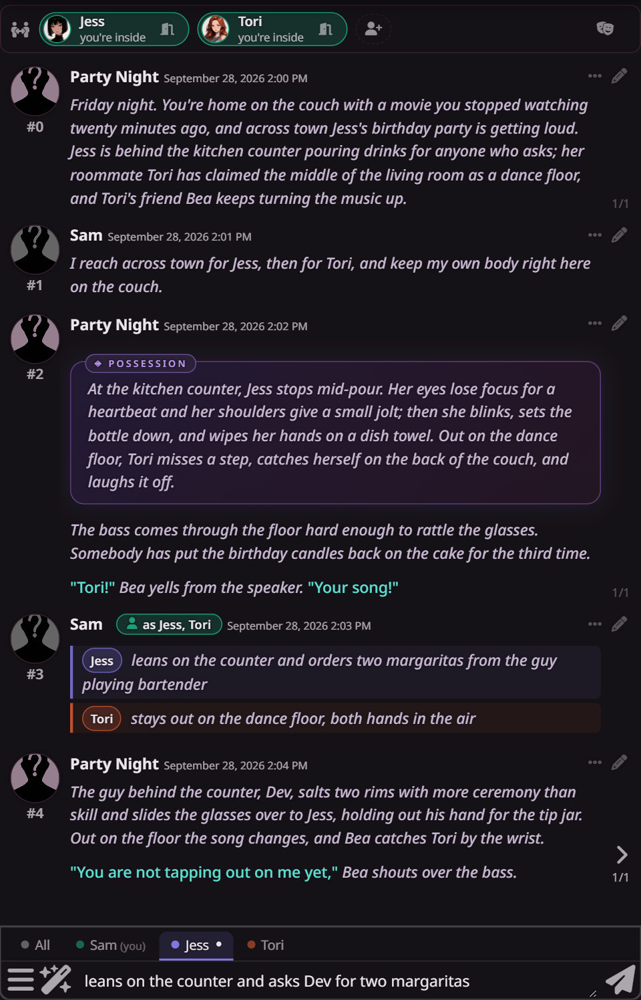

With Multipossession, or as a hive's original mind, you run more than one body at once. The message box makes that easy:

- **A tab per body** sits on the message box, in that body's color: **All** (for you as a whole), your own body marked *(you)*, and each body you're running. Each tab keeps its own draft, and a dot marks the tabs with something in them. **Alt+Left/Right** switches tabs.
- **Sending joins them** into one message: what's in All first, then a `[Jess]` line for each body with something in its tab. Write in a tab as "I": `[Jess] I lean on the counter` is Jess leaning on the counter. You can also type `[Jess]` or `Jess:` at the start of a line yourself.
- Your lines show in the chat as rows in the same colors.
- **Your bodies are yours.** The writer only ever does what you wrote with them, with nothing added. A body you gave nothing stays as you left it; if someone speaks to it, the reply stops and leaves the answer to you.
- **Bodies in different places** get one scene per place in the reply, each with its own heading, and nothing said in one place is heard in another (see [World notes](#-world-notes)).
- **Copies are their own people.** With Propagation, copies of you are separate people the writer plays, so they never get tabs.

<br clear="right">

## 💥 Moment boxes

<p align="center">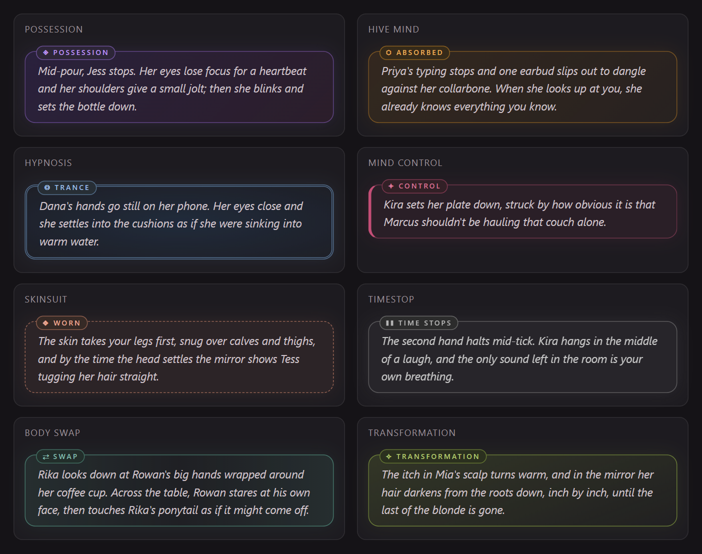</p>

The Codex asks the model to mark each mode's big moment, and a display-only regex script turns the marked passage into a styled box. Only the moment gets a box (one to three paragraphs, never the whole reply), the prose inside reads exactly as it would without it, and **nothing you haven't been told about ever gets a box**, since the box itself would give it away.

| Mode | The moment | Marked as |
|---|---|---|
| Possession | a takeover, and a release | `%%possession%%`, `%%release%%` |
| Hive Mind | someone being absorbed | `%%absorbed%%` |
| Skinsuit | a suit going on, and coming off | `%%worn%%`, `%%shed%%` |
| Hypnosis | going under, or a trigger firing | `%%trance%%` |
| Mind Control | a will taking hold | `%%control%%` |
| Timestop | time stopping, and resuming | `%%timestop%%`, `%%resume%%` |
| Body Swap | a swap, and a swap back | `%%swap%%` |
| Transformation | a change, and a change back | `%%transform%%` |

Each marker closes with its slash twin (`%%/trance%%`). The model only sees these instructions for the modes you picked. In Stage mode, a takeover's box also says who it happened to ("Sam → Jess", with their faces).

## 🎬 Stage mode

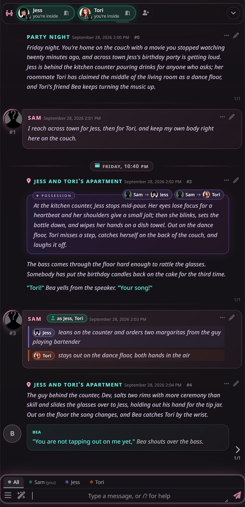

An optional new look for all of SillyTavern, built for the Engine. It ships **off**: switch it on at the top of the Worldhopper panel, from the wand menu, or with the masks at the end of the bodies strip. It says what it changes before it turns on, and switching it off puts everything back as it was. Nothing in your chats, cards, or settings is changed either way.

**The look.** The top bar, menus, buttons, popups, the chat, and the message box get Worldhopper's own style, drawn in your theme's colors. It works with or without [Moonlit Echoes](https://github.com/RivelleDays/SillyTavern-MoonlitEchoesTheme): with it, Stage takes Moonlit Echoes' theme colors and sizes; Moonlit Echoes' picture-led chat styles (Echo, Whisper, Hush, Ripple, Tide) step aside while Stage is on and come back when it's off.

**The chat**, read like a story:

- Narration stays on the page, and what someone says sits beside their face, under their name: the Engine's picture of them, their card's avatar, or your persona's. A body someone else is riding carries the rider's face, small, your own body included when someone has taken it. Tap a face to see it big, the way you would a card's picture; someone with no picture yet gets their picture card, to draw or add one.
- Who's speaking is read from the prose itself: the name beside the words, or the one person a "she says" can be. When it can't tell, the line stays narration rather than getting the wrong face.
- The card's picture and name step aside: each reply is headed by where the scene is (from the World notes), and the people in it carry their own names and faces.
- Where the story jumps in time or changes place, a divider shows the story's day and time ("Tuesday, 3:45 PM · an hour later").
- Your messages show the body you wrote them from, with your own face small on it, and your `[Jess]` lines carry Jess's face.

<br clear="right">

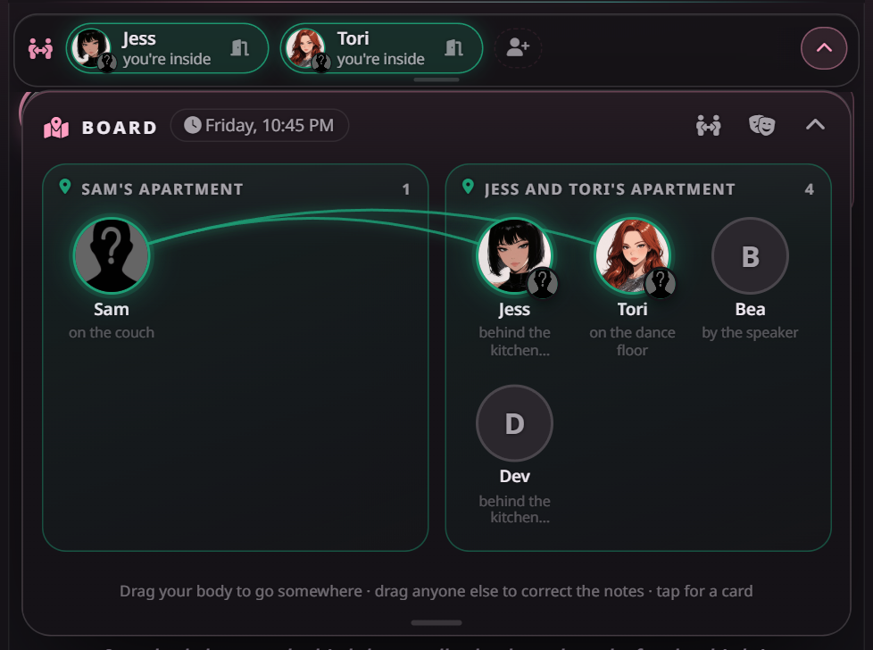

**The Board.** The bodies strip becomes a band at the top of the chat. Pull it down, or tap it, and the Board drops over the top of the chat: everyone the story is using, gathered into the places the World notes have them in, a rider's face on the body they're in, and a line from the rider's own body to it. Tap a face for their card.

- **Drag your own body** somewhere else and the move is written into your message (*I head to the stockroom.*); the World notes take it when you send. With several bodies, it goes in that body's tab.
- **Drag anyone else** to correct where the notes have them (the story isn't told they went).
- The eye in the Board's corner shows or hides the rides kept from you.

<br clear="right">

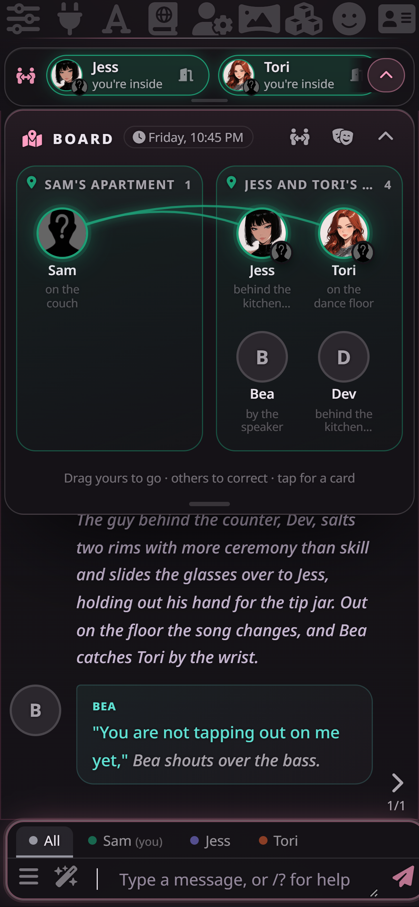

**The books as sheets.** The Body Ledger and the Mind Book open as a sheet instead of a popup: docked on the right on a wide screen, so the chat and the Board stay in reach, and up from the bottom on a phone, where you pull it down or tap outside to put it away. A tab switches between the two when a chat uses both.

**On phones** it's the same design, not a cut-down one: the band pulls down the same way, the Board's places stack, and the sheets come up from the bottom.

<br clear="right">

## ✍️ WH Editor

The prose Editor is its own extension, **[WH Editor](https://github.com/Coz-rp/SillyTavern-WH-Editor)**, so you can run it with any setup, or not at all. After each reply it flags stock phrases, "not X, but Y" framing, chopped dialogue, and other model tells, and has a cheap model rewrite only those lines.

The two work together: on a reply both of them touch, the Engine's body checks wait for the Editor to finish, and ⟲ takes the reply all the way back to the original. If you used the Editor while it was part of the Engine, its settings and slop list carry over when you install it.

## 🪪 Card tools

All in the wand menu.

- **Make card** turns a finished [Metaphysics Card Builder](https://coz-rp.github.io/) chat into a real character, with its Codex modes already picked.
- **Check card** reviews the open character's card: persona names where `{{user}}` belongs, a system prompt that replaces your preset's, too many tokens sent every reply, mind control written as a trapped victim, pointers in the greetings, and more. Inside it:
  - **Deeper review** asks your Notes model for a closer read.
  - **Test this card** writes a few first replies on your chat model, with your preset, this card, and the Codex, the way a new chat would, spread over all the card's greetings; your Notes model then checks each against the house rules and the card rules, and suggests one fix. It costs a few replies on your chat model.
  - **Check the greetings** reads every greeting the way the test reads replies, and each break comes back with words to put in its place. Apply them one at a time (and undo), since not every suggestion is right.

## ⚙️ Every setting

<p align="center">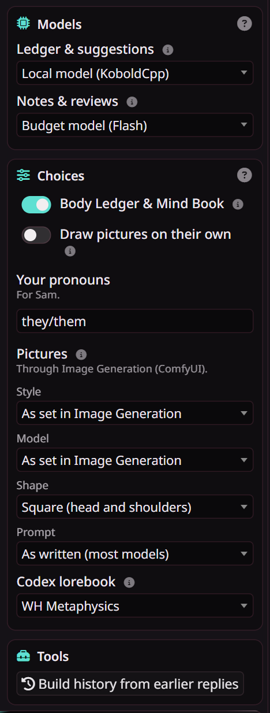</p>

### Models

Background jobs run through your connection profiles, separate from the model you chat with. **Use a local model or a cheap, fast API model for both**, not your roleplay model: the jobs are small, so a budget model does them well, and they stay quick and nearly free. A job with no model picked simply doesn't run.

| Setting | What it does | Suggested |
|---|---|---|
| Ledger & suggestions | Updates the Body Ledger and the World notes after every reply and the Mind Book when needed, runs the two body checks, and suggests modes for new characters | Your fastest, cheapest model: it runs the most, and your next reply waits for it |
| Notes & reviews | Writes Body History notes, host sheets, and the looks pictures are drawn from, reads card rules from a card, and runs Check card's reviews and tests | Runs rarely; cheap works, a slightly better model reads a little closer |

### On and off

The switch in the **Worldhopper Engine** heading turns all of it off without disabling the extension: nothing goes into your prompts, no background model runs, and Stage mode steps aside. What's already in your chats still shows (moment boxes, "As …" badges, ⟲ on edited replies), and your modes and Ledgers are kept for when you turn it back on.

**Stage mode** has its own switch at the top of the panel, off as shipped (see [Stage mode](#-stage-mode)).

### Choices

Everything else (mode reminders, detail entries, the strip, the body tabs, the World notes, Body History, the quick actions, and the pronoun and body-rule checks) is simply part of Worldhopper and runs whenever it's on.

| Setting | What it does | Default |
|---|---|---|
| Body Ledger & Mind Book | Tracks bodies and powers, the World notes, and what hypnosis, mind control, altered perception, and change over time have put into people, after replies in chats with those modes. Off, the mode rules still apply, but nothing runs in the background and your send never waits | On |
| Draw pictures on their own | Draws each new host once their sheet is written, each new person in the Mind Book, and, in Stage mode, anyone with a line in the latest replies. Off, tap a face to draw it. See [Pictures](#️-pictures) | Off |
| Your pronouns | Your pronouns for the persona you're using, kept per persona (also under its description in Persona Management) | Empty |
| Pictures: style, model, workflow, shape, prompt | What these pictures are drawn with, over your Image Generation setup: its own styles, models, and (for a source that has them) workflows; square head-and-shoulders (up to 1024×1024) or as set; and the prompt as written, or rewritten into tags by Image Generation's own template | As set; square; as written |
| Codex lorebook | Which lorebook holds the mode rules | WH Metaphysics |

### Tools

| Setting | What it does |
|---|---|
| Build history from earlier replies | For older chats: reads the replies with no Ledger entry, once each (the last 30, or the whole chat) |

## ⌨️ Slash commands

| Command | What it does |
|---|---|
| `/wh-modes` | Shows the current character's modes; `/wh-modes Possession, Skinsuit` sets them |
| `/wh-ledger` | Shows the Ledger; `edit` opens its cards; `rebuild`, `history`, and `backfill` do what they say |
| `/wh-mind` | Shows the Mind Book; `edit` opens its cards |

## 🧰 The regex scripts

All display-only: they change how messages look, never what the model reads.

| Script | What it does |
|---|---|
| WH - Possession | Turns a marked takeover into a possession box |
| WH - Release | Turns a marked release into a release box |
| WH - Moments | The boxes for every other mode's moment |
| WH - Place | Turns a scene's place line into a heading, when a reply comes as one scene per place |
| WH - Stray markers | Hides a marker whose partner went missing |
| WH - Body lines | Turns your `[Name]` lines into color-coded rows |

You can edit, disable, or delete them; the extension leaves your changes alone. They're also on [the site](https://coz-rp.github.io/) as files, in case you ever need to import them yourself.

## 🔒 Privacy

The extension sends chat text only to the connection profiles you pick under Models, plus your own chat model for one tool you start yourself:

- **The Ledger model** reads the last few messages after each reply for the Ledger and the World notes (and the reply itself, for the body checks); the Mind Book reads the same messages when it updates.
- **The Notes model** reads the messages around an ended body change, the latest messages and the card for a host's sheet or a picture's look, the card for card rules and Check card's reviews, the greetings for Check the greetings, and test replies for Test this card.
- **Your chat model** writes Test this card's replies, only when you tap it.
- **A picture's prompt** goes to whatever Image Generation source you've set up, the same as any picture you draw there.

Stage mode sends nothing anywhere: it all happens in your browser. Nothing else leaves your SillyTavern, and there's no telemetry.

## ❓ Troubleshooting

- **Nothing seems to happen.** Pick the character's modes (✏️ under Modes), and make sure a model is picked for **Ledger & suggestions**.
- **The Ledger got something wrong.** Tap its strip (or ✏️ on the Body Ledger), open the person's card, and use the ✏️ by the part that's wrong; the next update builds on your fix. 🔄 rebuilds it from the card and the last few messages.
- **Someone's in the wrong place on the Board.** Drag them to the right place (or fix **where** on their card).
- **A line in Stage mode got no face, or the wrong one.** Stage reads who's speaking from the prose, and leaves a line as narration when it can't tell. A name next to the words, or "she says" right after someone else's line, helps it. People the Ledger and World notes know, and people a card names with pronouns ("Kayla (she/her)"), are found best.
- **Stage mode doesn't sit well with my theme.** Switch it off at the top of the panel or from the wand menu; everything goes back as it was.
- **Deeper review or Test this card takes a while.** A thorough read usually takes under a minute on a cheap model; the button counts the seconds, a second tap cancels, and after three minutes a review stops on its own.
- **I see `%%trance%%` or other markers as text.** The display scripts are off or gone: check Extensions → Regex, or import them from [the site](https://coz-rp.github.io/).
- **"This version of Worldhopper has a newer Codex".** Your copy of WH Metaphysics has edits of your own, so it wasn't replaced. **Update (keep mine as a copy)** installs the new one and keeps yours alongside.
- **The Ledger stays off.** It only runs with a mode where someone inhabits another body (Possession, Skinsuit, Hive Mind, and the like); otherwise check that it's on under Settings → Choices and has a model.
- **The roleplay model ignores the mode reminders or the Ledger.** The Engine places them near the end of the prompt as system messages, and some providers drop or ignore system messages that come after the chat (Claude Sonnet through NanoGPT did, in testing). In your connection settings, set **Prompt Post-Processing** to **Semi-strict (no tools)**, which hands them to the model as part of the last message.
- **Text Completion.** The Codex, the Ledger, the World notes, and the body checks work the same as with Chat Completion.
- **A local model takes ages, keeps asking, or writes story where the update should be.** Each update sends instructions plus the latest messages, about 4,000 tokens, so the model needs a context of **8192 tokens or more**: set it where the model is loaded (KoboldCpp's Context Size, Ollama's num_ctx) and as **Context (tokens)** in SillyTavern. With less, the Engine trims the middle of the messages to fit, and warns you once if even its instructions don't (a server handed more than it holds cuts the instructions off the front, and the model just carries on the story). On a local model the Engine asks one thing at a time. Running the Engine on the same model you roleplay with works, but every update pushes the roleplay prompt out of the server's cache, so your next reply reads the whole chat again.
- **A picture doesn't draw.** Pictures go through SillyTavern's Image Generation: turn it on (Extensions → Image Generation), pick a source, and draw one picture there to check it works. Someone without a sheet also needs a Notes model to describe them, or a look you type.
- **Pictures don't look like the ones you usually make.** Two things do it. **Size:** a workflow with its own size draws pictures at that size, and a model or LoRA drawn far above about 1 megapixel can lose its look (an anime LoRA turning out photos); give pictures a workflow of their own at about 1 megapixel. **Style words:** the look you usually get may come from words in your prompts; put them in a Style and pick it under Settings → Pictures. With a tag-based model, also set Prompt to **Rewritten by Image Generation**.
- **Test this card says to reload.** It needs one SillyTavern reload after installing or updating the extension.

## 🔌 Optional: phone off-switch

`extras/wh-power` is a small Windows server plugin that adds **Shut down SillyTavern** to the wand menu, for switching SillyTavern off from your phone. It isn't installed with the extension; see its README.

## 💜 Credits

Worldhopper Engine by Coz, built with Claude. The Worldhopper presets, the Metaphysics Card Builder, and the WH Cardmaker preset are on [coz-rp.github.io](https://coz-rp.github.io/).

Two lines of the Metaphysics Core draw on other presets: the narrator settling how a power works when nothing else does comes from Nemo Vivarium, and suspicion that doesn't turn into interrogation from Sun Rider.
